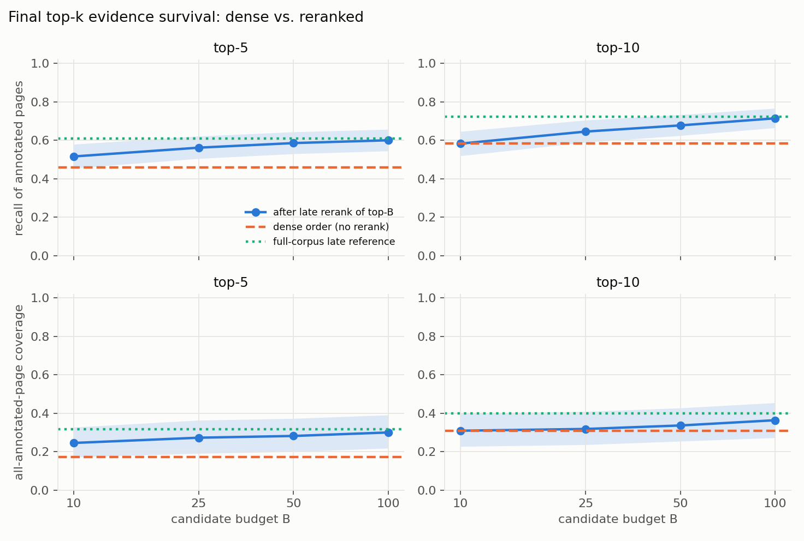
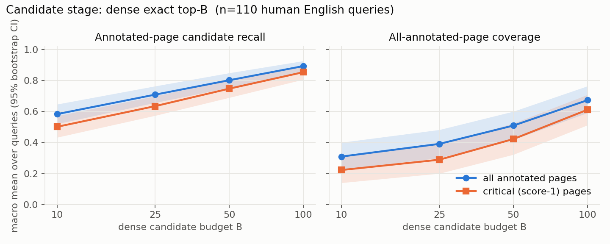

# Visual Evidence Candidate-Survival Kit

[](https://colab.research.google.com/github/inamdarmihir/visual-evidence-candidate-survival/blob/main/notebooks/visual_evidence_candidate_survival_t4.ipynb)


When a fast dense retriever keeps only the top‑**B** pages for a late‑interaction reranker, a relevant page outside the
top‑B can never be recovered. This kit measures **how many human‑annotated relevant pages survive** each stage of a
dense → late‑interaction cascade for B ∈ {10, 25, 50, 100}, using exact dense search in
[Qdrant](https://github.com/qdrant/qdrant) and server‑side MaxSim reranking with
[NeoMME‑260M‑Retriever](https://huggingface.co/Hcompany/NeoMME-260M-Retriever) on the
[ViDoRe v3](https://arxiv.org/abs/2601.08620) benchmark.

It is a **pinned, reproducible measurement**, not a new method or a general claim about reranking. See
[Limitations](#limitations).

## Pinned versions

| Component | Version / revision | Role |
|---|---|---|
| Dataset | `vidore/vidore_v3_computer_science` @ `d5cc75883d92e294f0c0fc2662551c9708a06ebc` | pages, queries, human qrels |
| Model | `Hcompany/NeoMME-260M-Retriever` @ `481083153ac22931afbd614e672212bffbcb666e` | one forward pass → dense (1024‑d) + multivector (128‑d / token) |
| Qdrant server | `v1.19.2` (binary SHA256‑verified) | exact dense search + MAX_SIM rerank |
| `qdrant-client` | `1.19.1` | client |
| `transformers` | `5.19.0` | model + processor (needs `torchvision`) |
| `sentence-transformers` | `6.1.0` | `util.mean_maxsim` parity reference |
| `datasets` | `5.1.0` | data loading |
| Precision | float32, no autocast | never switched silently |
| Resolution | longest side 1024 px (`primary_1024`) | resource‑bounded preset; the model default is 2048 |

Torch / torchvision come from the Colab runtime and are recorded per run in `run_manifest.json` and `pip_freeze.txt`.

## Result (verified, one domain, Colab Tesla T4)

110 human‑written English queries, 545 judged pages, 1,360 pages. Macro means, 95 % bootstrap CIs over whole queries
(2,000 replicates, seed 42). Full tables, strata and limits: [`RESULTS.md`](RESULTS.md).

| B | candidate recall | top‑10 recall after rerank | Δ vs dense order [95 % CI] |
|---|---|---|---|
| 10  | 0.583 | 0.583 | +0.000 (identical) |
| 25  | 0.709 | 0.646 | +0.063 [+0.030, +0.103] |
| 50  | 0.801 | 0.678 | +0.095 [+0.052, +0.141] |
| 100 | 0.893 | 0.715 | +0.132 [+0.084, +0.181] |

Dense order alone: 0.583. Unrestricted full‑corpus late‑interaction reference: 0.723. Reranking the top‑100 is not
distinguishable from that reference here (Δ = −0.009 [−0.027, +0.011]). Coverage of *all* annotated pages in the
top‑10 moves only from 0.31 to 0.36 and was not significant.




Cost on the T4: embedding 1,360 pages 328 s, Qdrant indexing 299 s, the whole rerank experiment 20 s; peak 2.3 GB VRAM,
3.7 GB host RAM, 0.64 GB Qdrant data. Qdrant vs torch MeanMaxSim agree to 1.4e‑7.

## Quick start (Google Colab, free T4)

1. Open the notebook with the badge above and select **Runtime → Change runtime type → T4 GPU**.
2. Run top to bottom. If the install cell asks for a restart, restart and run again from the top.
3. Defaults: `MODE="full"`, `DATASET="computer_science"`, `PRESET="primary_1024"`; a smoke fixture runs first
   (8 queries / 256 pages, engineering check only).
4. Optional section 15 repeats the same protocol on `hr`, `physics`, `energy`, `pharmaceuticals` (each pinned in
   `src/vesk/config.py`) and aggregates them. **It has not been run yet; no cross‑domain numbers exist.**

Every stage checkpoints per item with checksums and resumes after a disconnect (`USE_DRIVE=True` keeps checkpoints on
Drive; that path is untested). Nothing is published, and no paid service or secret is needed.

### Command line (GPU torch + torchvision already installed)

```bash
pip install -e .
vesk full --root ./work --full-late          # or: python -m vesk.cli full ...
python -m vesk.aggregate OUT_DIR run_a.zip run_b.zip   # combine finished full runs
pytest tests                                  # real pinned data, network required
```

## How it works

1. **Data gate.** Pinned revision; asserts counts and invariants; only `language == english AND query_generator == human`.
   The LLM‑merged `answer` and the `markdown` columns are never used.
2. **Embed once.** A single float32 forward pass gives `embeddings` (multivector) and `dense_embeddings`; per‑item
   checksummed shards; padding trimmed, all other positions kept.
3. **Index.** Qdrant collection with named vectors `dense` (cosine) and `late` (multivector, MAX_SIM, `m=0`, cold storage).
4. **Candidates → rerank.** Exact dense top‑B, then a server‑side `Prefetch` rerank with the late vector; nested budgets
   share one dense ranking.
5. **Parity.** Qdrant sum ÷ query‑token count must match `sentence_transformers.util.mean_maxsim` with masks.
6. **Metrics.** Candidate recall / coverage, final top‑5/10, nDCG (gain 2^score − 1), score‑1 / score‑2 diagnostics,
   paired bootstrap over query IDs, strata with *n*, and a loss label per page (candidate loss, reranking loss, survived).
7. **Traces.** `trace_viewer.html` shows deterministic example queries with the human boxes drawn on the pages; images
   are fetched on demand from the pinned revision.

## Repository layout

```
src/vesk/            pipeline (config, data, embed, qdrant_store, scoring, metrics, report, aggregate, cli)
notebooks/           Colab notebook (+ executed/ the v1 T4 run with outputs)
results/             verified outputs of the computer_science run (CSVs, plots, manifest, viewer)
docs/                PROTOCOL, LIMITATIONS, ATTRIBUTION, SOURCES, REFERENCES, BLOG_PROMPT
tests/               real-data tests (no synthetic fixtures)
tools/build_notebook.py   regenerates the notebook from src/
```

## Limitations

- One domain (two OpenStax textbooks), one model, one resolution, 110 queries; no general claim about reranking.
- Judgments are incomplete: unjudged pages are not negatives, so recall is a lower bound.
- Top‑k ceiling: 10 of 110 queries have more than 10 annotated pages, so best possible top‑10 recall is ≈ 0.974.
- No answer‑quality measurement. 1024 px is not a reproduction of published scores.
- Not run yet: the 2048 px preset, Drive resume, and the cross‑domain section.

## Licenses, attribution, sources

Code: MIT. ViDoRe v3 annotations: CC BY 4.0. Model: Apache 2.0. Page images are third‑party OpenStax material and are
**not** redistributed here. Details in [`docs/ATTRIBUTION.md`](docs/ATTRIBUTION.md); verified sources in
[`docs/SOURCES.md`](docs/SOURCES.md); reference papers in [`docs/REFERENCES.md`](docs/REFERENCES.md).

## Citing

If you use the data or model, cite ViDoRe V3 (arXiv:2601.08620) and NeoMME (arXiv:2609.01657). For this kit, cite the
repository URL and the commit hash you ran.
